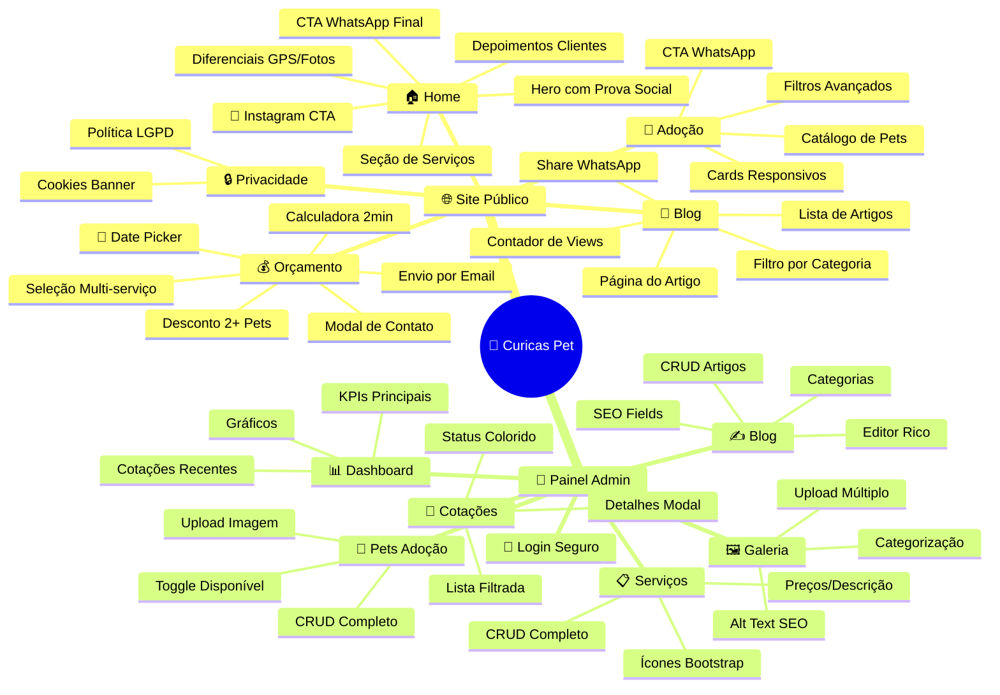
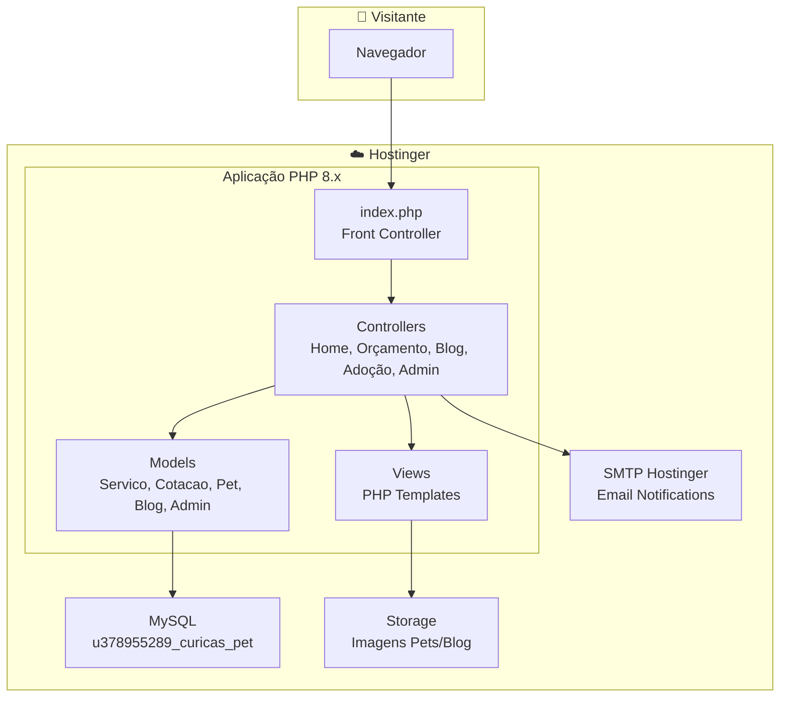
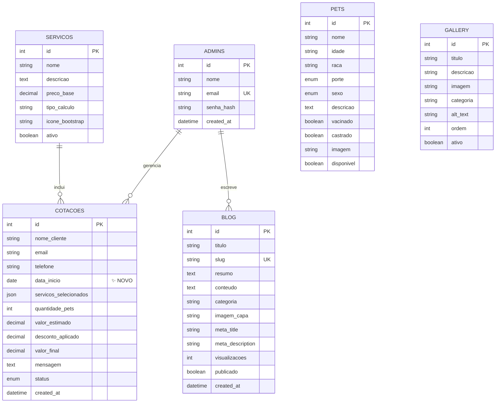

# 📋 Documentação Técnica - Curicas Pet

> **Versão:** 2.0  
> **Atualizado:** 12 Janeiro 2026  
> **Desenvolvido por:** Antigravity AI  
> **Cliente:** Curicas Pet

---

## 🗺️ Mapa Mental do Site



---

## 🏗️ Arquitetura do Sistema



---

## 📁 Estrutura de Arquivos Atualizada

```
curicas-pet/
├── index.php                 # Front Controller (roteamento)
├── .htaccess                 # Configuração Apache, HTTPS
├── robots.txt                # SEO - Crawlers
├── sitemap.xml               # SEO - Mapa do site
├── DOCUMENTACAO.md           # Este arquivo
├── LEIA_ME_DEPLOY.txt        # Guia de deploy
│
├── config/
│   ├── database.php          # Conexão PDO MySQL ⚠️ SENSÍVEL
│   ├── functions.php         # Helpers (safe, flash, redirect)
│   ├── business.php          # Dados do negócio (tel, email, redes)
│   └── email.php             # Configuração SMTP ⚠️ SENSÍVEL
│
├── controllers/
│   ├── HomeController.php    # Página inicial
│   ├── OrcamentoController.php # Calculadora + API email
│   ├── AdocaoController.php  # Catálogo de pets
│   ├── BlogController.php    # ✨ NOVO: Blog público + artigos
│   └── AdminController.php   # Painel administrativo completo
│
├── models/
│   ├── Servico.php           # CRUD serviços
│   ├── Cotacao.php           # CRUD cotações
│   ├── Pet.php               # CRUD pets adoção
│   ├── Blog.php              # ✨ NOVO: CRUD artigos
│   ├── Gallery.php           # ✨ NOVO: CRUD galeria
│   └── Admin.php             # Autenticação admin
│
├── views/
│   ├── home.php              # Home com Instagram CTA
│   ├── orcamento.php         # Calculadora + Date Picker
│   ├── adocao.php            # Catálogo pets
│   ├── blog.php              # ✨ NOVO: Lista de artigos
│   ├── artigo.php            # ✨ NOVO: Post individual
│   ├── privacidade.php       # Política LGPD
│   ├── 404.php               # Página não encontrada
│   │
│   ├── layouts/
│   │   └── base.php          # Template base (header/footer/SEO)
│   │
│   └── admin/
│       ├── login.php
│       ├── dashboard.php
│       ├── servicos.php      # Lista serviços
│       ├── servico_form.php  # Form criar/editar
│       ├── cotacoes.php      # Lista cotações
│       ├── cotacao_detalhe.php
│       ├── pets.php          # Lista pets
│       ├── pet_form.php      # Form criar/editar pet
│       ├── blog.php          # ✨ NOVO: Lista artigos
│       ├── blog_form.php     # ✨ NOVO: Editor artigos
│       ├── gallery.php       # ✨ NOVO: Galeria
│       └── partials/
│           └── sidebar.php   # Menu lateral admin
│
└── assets/
    ├── images/
    │   ├── logo-curicas-pet.png
    │   ├── favicon.png
    │   ├── pets/             # Fotos dos pets para adoção
    │   ├── blog/             # ✨ NOVO: Imagens dos artigos
    │   └── gallery/          # ✨ NOVO: Fotos galeria
    └── uploads/              # Uploads gerais
```

---

## 🗄️ Banco de Dados

### Diagrama ER Atualizado



### Tabelas do Sistema

| Tabela | Descrição | Status |
|--------|-----------|--------|
| `admins` | Usuários do painel | ✅ Ativo |
| `servicos` | Catálogo de serviços | ✅ Ativo |
| `cotacoes` | Solicitações de orçamento | ✅ Ativo |
| `pets` | Animais para adoção | ✅ Ativo |
| `blog` | Artigos do blog | ✨ Novo |
| `gallery` | Galeria de fotos | ✨ Novo |

---

## ✨ Funcionalidades Novas (v2.0)

### 1. Blog Completo
- Lista de artigos com paginação
- Filtro por categoria
- Contador de visualizações
- SEO individual por artigo
- Compartilhar via WhatsApp
- Editor no painel admin

### 2. Instagram CTA (Home)
- Seção com gradiente atrativo
- Mockup de celular
- Lista de benefícios
- Botão follow direto
- Localização: antes do CTA final

### 3. Date Picker (Orçamento)
- Biblioteca: Flatpickr
- Seleção de data de início
- Locale em português
- Apenas datas futuras
- Integrado ao formulário

### 4. Galeria de Fotos
- Upload múltiplo
- Categorização
- Alt text para SEO
- Ordenação por drag'n'drop

---

## 🎨 Guia de Alteração de Layout

### Como fazer mudanças visuais

#### 1. Mudar Cores da Marca

**Arquivo:** `views/layouts/base.php` (linhas 97-109)

```css
:root {
    --primary-color: #8FDC4F;     /* Verde principal */
    --primary-dark: #6BBF2D;      /* Verde escuro */
    --secondary-color: #4A9B2E;   /* Verde secundário */
    --accent-color: #FFB347;      /* Laranja destaque */
    --whatsapp-color: #25D366;    /* WhatsApp */
}
```

#### 2. Mudar Logo

1. Substitua o arquivo: `assets/images/logo-curicas-pet.png`
2. Mantenha dimensões próximas de **300x300px**
3. Use formato **PNG** com fundo transparente

#### 3. Mudar Textos/Conteúdo

| O que mudar | Arquivo | Seção |
|-------------|---------|-------|
| Nome da empresa | `config/business.php` | `nome_empresa` |
| Slogan | `config/business.php` | `slogan` |
| Telefone/WhatsApp | `config/business.php` | `whatsapp_num` |
| Redes sociais | `config/business.php` | `instagram_url`, `facebook_url` |
| Hero da home | `views/home.php` | Primeiras linhas |
| Depoimentos | `views/home.php` | Seção testimonials |

#### 4. Adicionar/Remover Menu

**Arquivo:** `views/layouts/base.php` (linhas 585-615)

```php
<li class="nav-item">
    <a class="nav-link" href="index.php?page=NOVA_PAGINA">
        <i class="bi bi-ICONE"></i> Nome do Link
    </a>
</li>
```

#### 5. Mudar Footer

**Arquivo:** `views/layouts/base.php` (linhas 643-709)

---

## 🛠️ Rotinas de Manutenção

### 💾 Backup

#### Frequência Recomendada

| Tipo | Frequência | Conteúdo |
|------|------------|----------|
| **Banco de Dados** | Semanal | Todas as tabelas |
| **Imagens** | Após uploads | `assets/images/` |
| **Completo** | Mensal | Todo `public_html` |

#### Como Fazer Backup do Banco

1. Hostinger → **phpMyAdmin**
2. Selecione o banco `u378955289_curicas_pet`
3. Aba **Exportar** → Formato **SQL**
4. Clique **Executar**
5. Salve como: `backup_curicas_AAAA-MM-DD.sql`

#### Como Fazer Backup dos Arquivos

1. Hostinger → **Gerenciador de Arquivos**
2. Botão direito em `public_html`
3. **Compactar** → ZIP
4. **Download** do arquivo
5. Salve em nuvem (Google Drive)

---

### 📅 Checklist de Rotinas

#### Semanal (~5 min)
- [ ] Verificar cotações pendentes
- [ ] Responder clientes via WhatsApp
- [ ] Atualizar status das cotações
- [ ] Checar email `contato@curicaspet.com.br`

#### Mensal (~15 min)
- [ ] Fazer backup do banco de dados
- [ ] Atualizar pets (adotados/novos)
- [ ] Publicar 1-2 artigos no blog
- [ ] Verificar site mobile e desktop
- [ ] Checar Google Search Console

#### Trimestral (~30 min)
- [ ] Backup completo (banco + arquivos)
- [ ] Revisar preços dos serviços
- [ ] Atualizar fotos/descrições
- [ ] Testar formulário de orçamento
- [ ] Verificar SSL válido

#### Anual
- [ ] Renovar domínio e hospedagem
- [ ] Atualizar senhas (admin, email)
- [ ] Revisar política de privacidade
- [ ] Atualizar dados de contato

---

## 🔑 Gerenciamento de Senhas

| Senha | Localização | Arquivo a Atualizar |
|-------|-------------|---------------------|
| **MySQL** | Hostinger → BD → Usuários | `config/database.php` |
| **Admin** | Tabela `admins` | phpMyAdmin (hash bcrypt) |
| **Email** | Hostinger → Emails | `config/email.php` |

### Alterar Senha do Admin

1. Gere hash em: https://bcrypt-generator.com/
2. Acesse **phpMyAdmin** → tabela `admins`
3. Edite o registro → cole hash no campo `senha`
4. Salve

> ⚠️ **Importante:** Sempre anote as senhas em local seguro!

---

## 📊 PageSpeed & SEO

### Pontuações Atuais

| Métrica | Mobile | Desktop |
|---------|:------:|:-------:|
| Performance | 71 | 97 |
| Acessibilidade | 93 | 93 |
| Práticas Recomendadas | 100 | 100 |
| SEO | 100 | 100 |

### SEO Implementado

- ✅ Meta tags dinâmicas
- ✅ Open Graph (Facebook/WhatsApp)
- ✅ Twitter Cards
- ✅ Schema.org LocalBusiness
- ✅ Sitemap.xml + Robots.txt
- ✅ Canonical URLs
- ✅ Geo tags (SEO local)
- ✅ Alt text em imagens

---

## 📞 Suporte & Contatos

| Serviço | Acesso |
|---------|--------|
| Hostinger | Central de Ajuda hPanel |
| Site Admin | curicaspet.com.br/index.php?page=admin |
| Email | contato@curicaspet.com.br |
| WhatsApp | (11) 96944-0485 |

---

## 📝 Changelog

### v2.0 - Janeiro 2026
- ✨ Blog completo com categorias
- ✨ Instagram CTA na home
- ✨ Date Picker no orçamento
- ✨ Galeria de fotos
- ✅ Correção botão Instagram
- ✅ Otimizações de acessibilidade
- 📊 Auditoria completa de produção

### v1.0 - Janeiro 2026
- ✅ Lançamento inicial
- ✅ Site público (Home, Orçamento, Adoção, Privacidade)
- ✅ Painel administrativo
- ✅ Sistema de cotações
- ✅ Design responsivo
- ✅ SEO otimizado
- ✅ Integração WhatsApp

---

> **Documentação Curicas Pet © 2026**  
> Atualizado em 12/01/2026 por Antigravity AI
