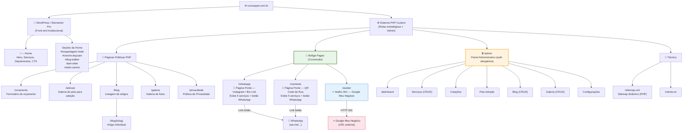
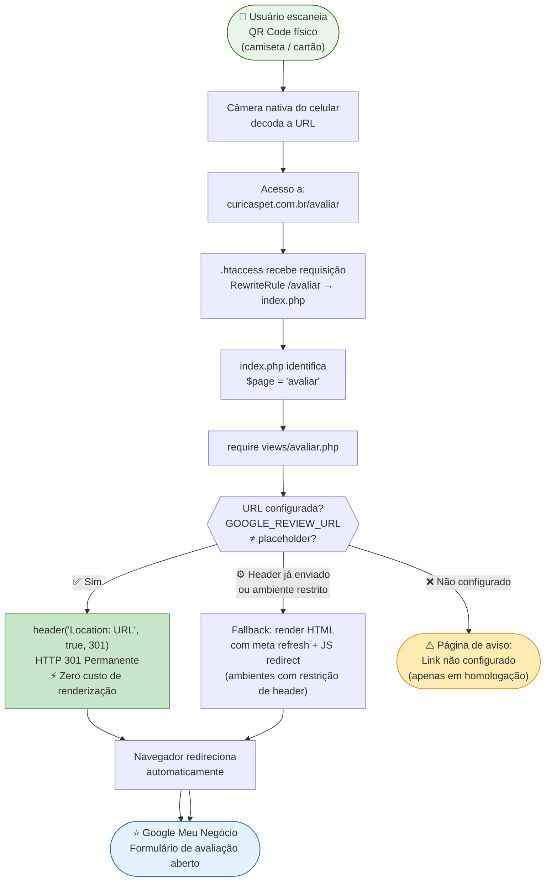
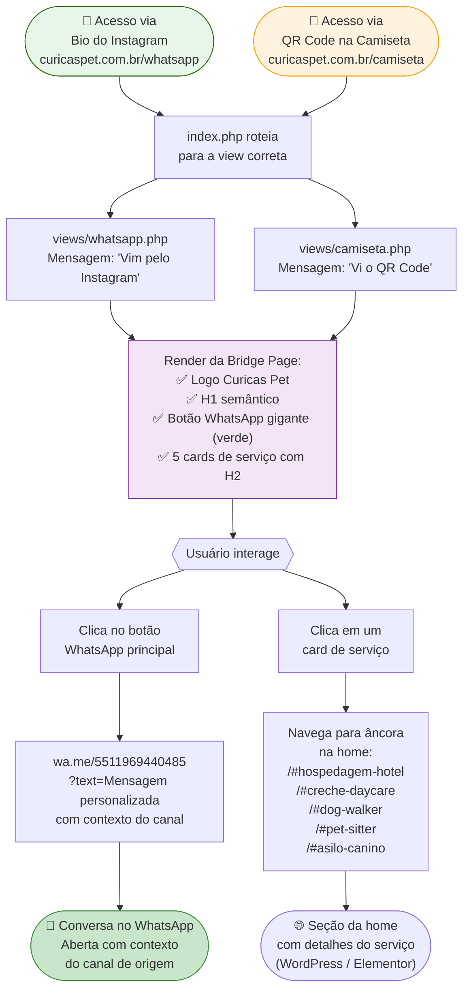

# 📄 Documentação Técnica Oficial — Curicas Pet
> **Versão:** 2.0 — Arquitetura Híbrida  
> **Última atualização:** Maio 2026  
> **Arquiteto:** Antigravity (sessão 7552fc5e)

---

## Índice

1. [PRD — Documento de Requisitos do Produto](#1-prd--documento-de-requisitos-do-produto)
2. [Guia de Manutenção](#2-guia-de-manutenção)
3. [Mapa do Site e Arquitetura](#3-mapa-do-site-e-arquitetura)
4. [Fluxogramas de Navegação](#4-fluxogramas-de-navegação)
5. [Mentoria Prática — Ícone Pet Sitter](#5-mentoria-prática--ícone-pet-sitter)

---

## 1. PRD — Documento de Requisitos do Produto

### 1.1 Contexto e Visão Geral

O **Curicas Pet** opera em **arquitetura híbrida**: o front-end institucional roda em WordPress/Elementor Pro, enquanto rotas estratégicas de alta conversão e o painel administrativo operam sobre um sistema PHP customizado com padrão MVC, roteamento por front-controller e banco de dados MySQL.

> [!IMPORTANT]
> Toda manutenção de conteúdo institucional (hero, textos de seções, galeria do WP) é feita no Elementor. As rotas listadas abaixo são **exclusivas do sistema PHP custom** e **não devem ser gerenciadas pelo WP**.

---

### 1.2 Requisitos Funcionais (RF)

| ID | Requisito | Implementado em | Status |
|---|---|---|---|
| **RF-01** | O sistema deve redirecionar `/avaliar` com HTTP 301 permanente para a URL do Google Meu Negócio | `views/avaliar.php` | ✅ |
| **RF-02** | O redirecionamento deve ter fallback em `<meta http-equiv="refresh">` e JavaScript para ambientes com restrição de headers | `views/avaliar.php` | ✅ |
| **RF-03** | A rota `/camiseta` deve exibir os 5 serviços oficiais ordenados (Hotel Pet, Creche, Dog Walker, Pet Sitter, Asilo) com link direto para a seção correspondente na home | `views/camiseta.php` | ✅ |
| **RF-04** | A rota `/whatsapp` deve exibir os mesmos 5 serviços oficiais da `/camiseta`, garantindo consistência do portfólio em todos os canais de aquisição | `views/whatsapp.php` | ✅ |
| **RF-05** | O botão principal de WhatsApp deve gerar uma mensagem de contexto diferente por canal: rua (QR Code da camiseta) vs Instagram (bio link) | `views/camiseta.php` L.18–19 e `views/whatsapp.php` L.18–19 | ✅ |
| **RF-06** | O sistema deve listar serviços do banco de dados dinamicamente no painel admin (CRUD completo) | `models/Servico.php`, `controllers/AdminController.php` | ✅ |
| **RF-07** | O sitemap dinâmico (`/sitemap.xml`) deve incluir URLs das rotas PHP customizadas | `sitemap.php` | ✅ |
| **RF-08** | ⚠️ A URL real do Google Meu Negócio deve ser configurada em `views/avaliar.php` | `views/avaliar.php` linha 21 | ⏳ **Pendente** |

---

### 1.3 Requisitos Não Funcionais (RNF)

#### Performance / Core Web Vitals

| ID | Requisito | Implementação |
|---|---|---|
| **RNF-01** | LCP das Bridge Pages ≤ 1.5s | Logo com `fetchpriority="high"` + ícones carregados assincronamente (`rel="preload"` com `onload`) |
| **RNF-02** | Redirecionamento `/avaliar` com zero custo de renderização | `header('Location: ...', true, 301)` emitido antes de qualquer output HTML |
| **RNF-03** | FCP não bloqueado por ícones externos | Font Awesome e Bootstrap Icons carregados via `preload as="style"` + `<noscript>` fallback |
| **RNF-04** | Google Fonts sem bloqueio | `display=swap` ativo, `preconnect` para `fonts.googleapis.com` e `fonts.gstatic.com` |
| **RNF-05** | Assets estáticos com cache agressivo | `.htaccess`: imagens 1 mês, CSS/JS 1 semana, fontes 3 meses (`mod_expires`) |
| **RNF-06** | Compressão GZIP ativa | `.htaccess`: `mod_deflate` em HTML, CSS, JS, JSON, XML |

#### SEO Técnico

| ID | Requisito | Implementação |
|---|---|---|
| **RNF-07** | Cada rota PHP deve ter `<title>`, `<meta description>`, `<link rel="canonical">` únicos e otimizados para busca local | Todas as views de bridge page |
| **RNF-08** | Hierarquia semântica obrigatória: 1 `<h1>` por página, `<h2>` nos títulos de cards de serviço | `/camiseta` e `/whatsapp` |
| **RNF-09** | Open Graph completo (title, description, url, image, site_name, locale) em todas as bridge pages | Ambas as views |
| **RNF-10** | `robots: index, follow` nas bridge pages (são páginas de conversão SEO) | Ambas as views |
| **RNF-11** | Redirecionamentos 301 (não 302) para preservar autoridade de link | `.htaccess` e `views/avaliar.php` |
| **RNF-12** | URLs canônicas construídas via `business.php['site_url']` — nunca hardcoded | Todas as views |

#### Segurança

| ID | Requisito | Implementação |
|---|---|---|
| **RNF-13** | Proteção XSS em todas as saídas dinâmicas | `htmlspecialchars($v, ENT_QUOTES \| ENT_SUBSTITUTE, 'UTF-8')` via `$safe()` inline |
| **RNF-14** | Proteção SQL Injection via PDO com prepared statements | `models/*.php` — todos os queries parametrizados |
| **RNF-15** | Sanitização de input de rota | `index.php` L.54: `preg_replace('/[^a-z0-9_\-]/', '', ...)` antes de qualquer uso |
| **RNF-16** | Listagem de diretórios desativada | `.htaccess`: `Options -Indexes` |
| **RNF-17** | Arquivos sensíveis bloqueados por HTTP | `.htaccess`: `config/`, `models/`, `controllers/`, `.sql`, `.env`, `.log`, `.bak` com `[F,L]` e `Deny from all` |
| **RNF-18** | Headers HTTP de segurança | CSP, HSTS (1 ano), X-Frame-Options, X-Content-Type-Options, COOP, Referrer-Policy, Permissions-Policy |
| **RNF-19** | Arquivos `debug.php` e `debug_admin.php` bloqueados ou removidos em produção | ⚠️ **Pendente** — adicionar regra no `.htaccess` |
| **RNF-20** | HTTPS forçado via redirect 301 | `.htaccess` L.14–15 |

---

### 1.4 Regras de Negócio (RN)

#### RN-01 — Os 5 Serviços Oficiais

> [!IMPORTANT]
> O Curicas Pet oferece **exatamente 5 serviços**. Nenhuma view, card, sitemap ou material de marketing deve listar mais ou menos que estes, e **na ordem exata abaixo**:

| Ordem | Serviço | Âncora na Home | Ícone Bootstrap Icons |
|---|---|---|---|
| 1 | **Hotel Pet** | `/#hospedagem-hotel` | `bi-house-heart-fill` (verde `#4A9B2E`) |
| 2 | **Creche Diurna** | `/#creche-daycare` | `bi-sun-fill` (âmbar `#F0A500`) |
| 3 | **Passeios Educativos (Dog Walker)** | `/#dog-walker` | `bi-geo-alt-fill` (verde-escuro `#2D6A0A`) |
| 4 | **Pet Sitter** | `/#pet-sitter` | `bi-shield-heart-fill` (azul `#5B8DD9`) |
| 5 | **Asilo Pet** | `/#asilo-canino` | `bi-heart-pulse-fill` (rosa `#e05c7a`) |

> [!WARNING]
> Serviços **NÃO oferecidos** (removidos em auditoria anterior): Banho, Tosa, Estética Pet. Nunca reintroduzi-los em nenhum arquivo.

#### RN-02 — Mensagens de WhatsApp por Canal

| Canal | Mensagem pré-preenchida |
|---|---|
| Instagram / Link Bio (`/whatsapp`) | "Olá! Vim pelo Instagram e gostaria de saber mais sobre os serviços da Curicas Pet. 🐾" |
| QR Code de Rua / Camiseta (`/camiseta`) | "Olá! Vi o QR Code da Curicas Pet e gostaria de saber mais sobre os serviços. 🐾" |

#### RN-03 — Hierarquia de Roteamento (Prioridades)

```
P1: /blog/{slug}        → BlogController::artigo()
P2: ?page=X (query)     → Controller mapeado
P3: /admin(/*)          → AdminController
P4: Clean URLs mapeadas → Controller ou view direta
P5: Fallback            → home
```

#### RN-04 — Indexação de Bridge Pages

As rotas `/whatsapp` e `/camiseta` são `index, follow`. São páginas de conversão que podem aparecer no Google para buscas de marca. A rota `/avaliar` não necessita de indexação (é um redirect puro), mas como emite o 301 antes de HTML, o Google não a indexa de forma independente.

---

## 2. Guia de Manutenção

### 2.1 Árvore de Diretórios do Sistema PHP Custom

```mermaid
graph TD
    ROOT["📁 curicas-pet/ (raiz)"]

    ROOT --> HTACCESS["⚙️ .htaccess\nRoteamento, Segurança, Cache, GZIP"]
    ROOT --> INDEX["🚪 index.php\nFront Controller — ponto de entrada único"]
    ROOT --> SITEMAP["🗺️ sitemap.php\nSitemap XML dinâmico"]
    ROOT --> ROBOTS["🤖 robots.txt"]

    ROOT --> CONFIG["📁 config/"]
    CONFIG --> BUSINESS["business.php\n🏢 Dados da empresa\n(WhatsApp, endereço, og_image, site_url)"]
    CONFIG --> DATABASE["database.php\n🗄️ Conexão PDO com MySQL"]
    CONFIG --> APP["app.php\n⚙️ Constantes globais da aplicação"]
    CONFIG --> FUNCTIONS["functions.php\n🛠️ Helpers globais"]
    CONFIG --> EMAIL["email.php\n📧 Config SMTP"]

    ROOT --> CONTROLLERS["📁 controllers/"]
    CONTROLLERS --> HC["HomeController.php"]
    CONTROLLERS --> OC["OrcamentoController.php"]
    CONTROLLERS --> AC["AdocaoController.php"]
    CONTROLLERS --> BC["BlogController.php"]
    CONTROLLERS --> ADC["AdminController.php\n(CRUD completo: Serviços, Blog, Pets, Galeria, Cotações)"]

    ROOT --> MODELS["📁 models/"]
    MODELS --> SM["Servico.php"]
    MODELS --> CM["Cotacao.php"]
    MODELS --> PM["Pet.php"]
    MODELS --> BM["Blog.php"]
    MODELS --> GM["Gallery.php"]
    MODELS --> AM["Admin.php"]

    ROOT --> VIEWS["📁 views/"]
    VIEWS --> LAYOUTS["📁 layouts/\nbase.php (nav + footer)"]
    VIEWS --> BRIDGE["🔗 Bridge Pages (autossuficientes)"]
    BRIDGE --> WA["whatsapp.php\n/whatsapp — Bio do Instagram"]
    BRIDGE --> CAM["camiseta.php\n/camiseta — QR Code de rua"]
    BRIDGE --> AV["avaliar.php\n/avaliar — Redirect 301 Google"]
    VIEWS --> PUB["📄 Páginas Públicas"]
    PUB --> HOME["home.php"]
    PUB --> ORC["orcamento.php"]
    PUB --> ADO["adocao.php"]
    PUB --> BLG["blog.php / blog_artigo.php"]
    PUB --> GAL["galeria.php"]
    PUB --> PRIV["privacidade.php"]
    VIEWS --> ADMIN_V["📁 admin/ (painel)"]

    ROOT --> SCRIPTS["📁 scripts/"]
    SCRIPTS --> QR["generate_qr_premium.py\n🐾 Gerador de QR Codes Premium"]

    style BRIDGE fill:#e8f5e9,stroke:#2D6A0A
    style BUSINESS fill:#fff3e0,stroke:#F0A500
    style DATABASE fill:#e3f2fd,stroke:#1565C0
    style INDEX fill:#fce4ec,stroke:#c62828
    style HTACCESS fill:#f3e5f5,stroke:#6a1b9a
```



---

### 2.2 Cheat Sheet — "Onde mexer para alterar X"

| O que você quer alterar | Arquivo | Linha / Seção | Observação |
|---|---|---|---|
| **Link de destino do Google Meu Negócio** | [`views/avaliar.php`](file:///Users/paulobarbosa/Documents/curicaspet/curicas-pet/views/avaliar.php) | Linha **21** — constante `GOOGLE_REVIEW_URL` | Cole a URL gerada em `business.google.com → Pedir avaliações` |
| **Textos e HTML da view WhatsApp** | [`views/whatsapp.php`](file:///Users/paulobarbosa/Documents/curicaspet/curicas-pet/views/whatsapp.php) | Bloco `<body>` → `<main class="bridge-card">` | Não altera nenhum Controller — é uma view standalone |
| **Textos e HTML da view Camiseta** | [`views/camiseta.php`](file:///Users/paulobarbosa/Documents/curicaspet/curicas-pet/views/camiseta.php) | Bloco `<body>` → `<main class="bridge-card">` | Mesma estrutura da view WhatsApp |
| **Ícones dos cards de serviço** | `views/whatsapp.php` ou `views/camiseta.php` | Tags `<i class="bi bi-...">` dentro de cada `<a class="btn-bridge-secondary">` | Ver RN-01 para a lista de ícones e cores |
| **Número do WhatsApp** | [`config/business.php`](file:///Users/paulobarbosa/Documents/curicaspet/curicas-pet/config/business.php) | Chave `'whatsapp_num'` | Apenas dígitos com DDI+DDD (ex: `5511969440485`) |
| **Dados da empresa (nome, endereço, redes sociais)** | [`config/business.php`](file:///Users/paulobarbosa/Documents/curicaspet/curicas-pet/config/business.php) | Todo o arquivo | Fonte única de verdade para todas as views |
| **Conexão com o banco de dados** | [`config/database.php`](file:///Users/paulobarbosa/Documents/curicaspet/curicas-pet/config/database.php) | Credenciais PDO (host, dbname, user, password) | Nunca commitar no git com dados reais |
| **Adicionar ou remover uma rota Clean URL** | [`index.php`](file:///Users/paulobarbosa/Documents/curicaspet/curicas-pet/index.php) | Array `$cleanRoutes` (L.28–38) + bloco `if ($page === '...')` (L.111–124) | Também adicionar a RewriteRule no `.htaccess` |
| **Regras de segurança e bloqueios** | [`.htaccess`](file:///Users/paulobarbosa/Documents/curicaspet/curicas-pet/.htaccess) | Seções 5 (Bloqueio), 6 (Headers de Segurança) | Cuidado: erro de sintaxe aqui derruba o site |
| **Regras de cache de assets** | [`.htaccess`](file:///Users/paulobarbosa/Documents/curicaspet/curicas-pet/.htaccess) | Seção 7 (`mod_expires`) | Ajustar após mudanças em imagens/CSS/JS críticos |
| **Sitemap (adicionar nova URL)** | [`sitemap.php`](file:///Users/paulobarbosa/Documents/curicaspet/curicas-pet/sitemap.php) | Array de URLs estáticas | Após editar, invalide o cache no Google Search Console |
| **Lógica CRUD de serviços (admin)** | [`controllers/AdminController.php`](file:///Users/paulobarbosa/Documents/curicaspet/curicas-pet/controllers/AdminController.php) + [`models/Servico.php`](file:///Users/paulobarbosa/Documents/curicaspet/curicas-pet/models/Servico.php) | Métodos `servico*` no controller | Queries PDO parametrizadas no model |
| **Geração dos QR Codes para gráfica** | [`scripts/generate_qr_premium.py`](file:///Users/paulobarbosa/Documents/curicaspet/curicas-pet/scripts/generate_qr_premium.py) | Executar: `python3 scripts/generate_qr_premium.py` | Saída em `assets/images/qrcodes/` — 2400px @ 300 DPI |
| **SEO title/description das bridge pages** | `views/whatsapp.php` ou `views/camiseta.php` | Variáveis `$pageTitle` e `$pageDescription` no bloco PHP inicial (L.21–22) | Editável sem tocar no HTML |

---

## 3. Mapa do Site e Arquitetura



---

## 4. Fluxogramas de Navegação

### Fluxo A — Offline to Online (QR Code → Google Avaliações)



---

### Fluxo B — Conversão Comercial (Bio Link ou QR Code de Rua → WhatsApp)



---

## 5. Mentoria Prática — Ícone Pet Sitter

> [!NOTE]
> Você identificou que o ícone do card **Pet Sitter** não está aparecendo na view do WhatsApp. Abaixo está o roteiro de investigação e correção que você deve executar manualmente — sem código pronto. O objetivo é você aprender a navegar e manter o HTML das views.

---

### 🧭 Passo 1 — Abra o arquivo correto

Navegue até:
```
views/whatsapp.php
```
Abra-o no seu editor de texto. Você pode usar qualquer editor (VS Code, PhpStorm, Notepad++, etc.).

---

### 🔍 Passo 2 — Localize o card do Pet Sitter

Use a função de busca do seu editor (**Ctrl+F** no Windows / **Cmd+F** no Mac) e pesquise pelo texto:

```
Pet Sitter
```

Você vai encontrar um bloco `<a class="btn-bridge-secondary">` com um `<h2>Pet Sitter</h2>` dentro. Esse é o card que precisa de atenção.

---

### 🔬 Passo 3 — Inspecione a tag `<i>` dentro do card

Dentro do bloco que você encontrou, observe a primeira linha — ela começa com uma tag `<i>`. O padrão de todos os outros cards do site segue esta estrutura:

```
<i class="[BIBLIOTECA] [NOME-DO-ÍCONE] icon-main" aria-hidden="true" style="color:[COR];"></i>
```

Onde:
- `[BIBLIOTECA]` é o prefixo que identifica qual biblioteca de ícones está sendo usada
  - Bootstrap Icons usa o prefixo: `bi`
  - Font Awesome usa o prefixo: `fas`, `fab`, `far`
- `[NOME-DO-ÍCONE]` é a classe específica do ícone (ex: `bi-house-heart-fill`)

**Compare a tag `<i>` do card Pet Sitter com as dos outros cards.** Procure por diferenças: nome errado de classe, espaço faltando, prefixo errado, ou a tag simplesmente ausente.

---

### 💡 Passo 4 — Escolha o ícone correto

Você tem duas opções excelentes de ícones que representam semanticamente o serviço de **Pet Sitter** (cuidado profissional no lar):

**Opção A — Bootstrap Icons** *(prefixo `bi`)*

| Nome da classe | Visual | Indicação |
|---|---|---|
| `bi-shield-heart-fill` | Escudo com coração | Proteção + cuidado |
| `bi-house-heart` | Casa com coração | Cuidado em casa |
| `bi-person-hearts` | Pessoa com corações | Cuidador carinhoso |

**Opção B — Font Awesome** *(prefixo `fas`)*

| Nome da classe | Visual | Indicação |
|---|---|---|
| `fas fa-hand-holding-heart` | Mão segurando coração | Cuidado afetuoso |
| `fas fa-user-nurse` | Ícone de cuidador | Profissionalismo |

> [!TIP]
> Para confirmar se um ícone existe na versão carregada pelo projeto (**Bootstrap Icons 1.11.1**), acesse: **https://icons.getbootstrap.com** e use o campo de busca. O projeto já carrega esta biblioteca — qualquer ícone encontrado lá funcionará diretamente.

---

### ✏️ Passo 5 — Aplique a correção

Com o nome do ícone em mãos, edite a tag `<i>` do card Pet Sitter seguindo **exatamente** o padrão dos outros cards. Preste atenção em:

1. O prefixo correto da biblioteca (`bi` para Bootstrap Icons)
2. O nome completo da classe do ícone
3. A presença de `icon-main` como segunda classe
4. O atributo `aria-hidden="true"` (obrigatório para acessibilidade)
5. O atributo `style="color:#5B8DD9;"` — a cor azul definida para este serviço

---

### ✅ Passo 6 — Valide no navegador

Após salvar o arquivo, abra `curicaspet.com.br/whatsapp` (ou `localhost/whatsapp`) e:

1. Faça **Ctrl+Shift+R** (hard reload, sem cache) para ver as mudanças
2. Confirme que o ícone aparece ao lado do texto "Pet Sitter"
3. Verifique que a cor está em azul (`#5B8DD9`), igual à especificada na RN-01

Se o ícone aparecer como um quadrado vazio ou um `?`, significa que o nome da classe está errado — volte ao Passo 4 e verifique o nome exato no site oficial do Bootstrap Icons.

---

*Documentação gerada por Antigravity — sessão `7552fc5e` — Maio 2026*
